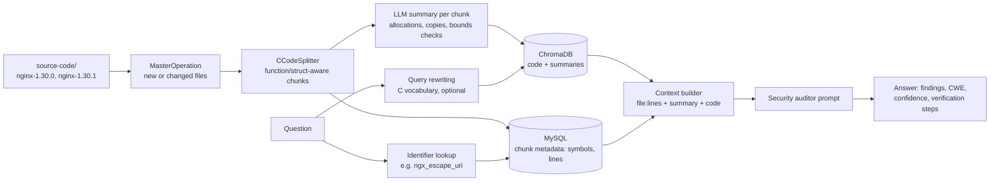

# Security RAG Assistant for C/C++ Code

A local, private Retrieval-Augmented Generation (RAG) assistant for **auditing C/C++ code for memory-safety bugs**. It is set up for the **Nginx** code base, with **CVE-2026-42945** (a heap buffer overflow in Nginx's rewrite module) as the case study.

You index a C source tree into a local vector database, then ask questions in plain English, such as *"Where is this heap buffer sized, and is every write into it bounds-checked?"*. The assistant retrieves the relevant functions and their summaries and answers as a **Senior C/C++ Security Auditor**, citing file and line ranges.

Everything runs on your machine; no source code or questions leave it.

| Component | Role |
|---|---|
| **[Ollama](https://ollama.com/)** | Local LLM (summaries, query rewriting, answers) and embedding model |
| **[LangChain.js](https://js.langchain.com/)** | Prompt templates, the retrieval pipeline |
| **[ChromaDB](https://www.trychroma.com/)** | Vector store for code chunks and their summaries |
| **MySQL / MariaDB** | Ingestion state (resumable, incremental) and the symbol index |
| **Node.js / TypeScript / Express** | API server, ingestion pipeline, scripts |

> **Research tool, not an oracle.** The assistant finds *leads*. Every finding must be checked by hand and confirmed with tools such as AddressSanitizer, fuzzing, or a test against a debug build. Report new vulnerabilities through responsible disclosure (for Nginx, see the [security advisories page](https://nginx.org/en/security_advisories.html)).

This project is a fork of [danielefavi/ai-codebase-assistant](https://github.com/danielefavi/ai-codebase-assistant), a general-purpose codebase RAG assistant. The [changes from the original](#what-this-fork-changes) are listed below.

---

## Case Study: CVE-2026-42945

CVE-2026-42945 is a heap buffer overflow in `ngx_http_rewrite_module`, publicly disclosed in May 2026.

- **Affected:** NGINX Open Source 0.6.27 to 1.30.0. **Fixed** in 1.30.1 and 1.31.0.
- **Severity:** CVSS v4.0 9.2 (F5); CVSS v3.1 8.1 (Red Hat). CWE-131 (incorrect calculation of buffer size).
- **Trigger:** a `rewrite` whose replacement uses an unnamed PCRE capture (`$1`, …) and contains a `?`, followed in the same scope by another `rewrite`, `if` or `set` that uses captures. A request whose URI contains percent-encoded characters or `+` then overflows a heap buffer in the worker. Impact is a worker crash (DoS); code execution has been described as possible when ASLR is disabled.

### Root cause (from the upstream fix)

The fix is upstream commit [`524977e`](https://github.com/nginx/nginx/commit/524977e7) *"Rewrite: fixed escaping and possible buffer overrun"*, a **one-line change** in `src/http/ngx_http_script.c`:

```diff
 ngx_http_script_regex_end_code(ngx_http_script_engine_t *e)
 ...
+    e->is_args = 0;
     e->quote = 0;
```

Nginx evaluates rewrite and `set`/`if` values with a small script engine that works in **two passes**: a *length* pass computes the buffer size, then a *copy* pass writes into the buffer.

1. When the rewrite replacement reaches its `?`, `ngx_http_script_start_args_code` sets `e->is_args = 1` on the main engine. Before the fix, nothing cleared it when the rewrite finished.
2. A later `set $x $1;` (or `if`) runs `ngx_http_script_complex_value_code`. Its length pass runs on a **fresh, zeroed engine**, so `is_args` is 0 and each capture is counted at its raw length. The buffer is allocated with `ngx_pnalloc` for that size.
3. The copy pass, `ngx_http_script_copy_capture_code`, runs on the **main engine**, where `is_args` is still 1. If the request URI was percent-encoded or contained `+` (`quoted_uri` / `plus_in_uri`), the capture is written through `ngx_escape_uri(..., NGX_ESCAPE_ARGS)`, which can turn one byte into three (`%XX`). The copy has no bounds check, so it writes past the end of the buffer.

This is the kind of bug the project targets: no single line is wrong. The length pass and the copy pass disagree because of state carried between functions spread over about 700 lines of the file. Finding it means retrieving `ngx_http_script_start_args_code`, `ngx_http_script_regex_end_code`, `ngx_http_script_complex_value_code` and `ngx_http_script_copy_capture_code` together.

Release 1.30.1 also fixed a buffer over-read in the charset filter (`ngx_http_charset_recode_from_utf8`) and an upstream status-line parsing bug. These make useful extra test questions (see [Evaluation](#evaluation)).

References: [F5 advisory K000161019](https://my.f5.com/manage/s/article/K000161019) · [NVD](https://nvd.nist.gov/vuln/detail/CVE-2026-42945) · [Red Hat](https://access.redhat.com/security/cve/cve-2026-42945) · upstream commit `524977e7` (`git log release-1.30.0..release-1.30.1` in the nginx repository)

---

## How It Works



1. **Scanning.** Every `.c` / `.h` file under `source-code/` is hashed. Only new or changed files are queued, so indexing can be stopped and resumed. The first folder under `source-code/` becomes the file's **code base** label (for example `nginx-1.30.0`).
2. **C-aware chunking** with `CCodeSplitter` (details below). Large files are indexed only through their chunks; small files that fit in one chunk are indexed whole.
3. **Security-oriented summaries.** Each chunk is summarized by the LLM with attention to allocations, size arithmetic, copies, bounds checks and attacker-controlled input. Summaries are embedded next to the code, so a question in English (*"buffer sized from regex captures"*) can match code that never uses those words.
4. **Hybrid retrieval.** The question (optionally rewritten into C vocabulary) is embedded and matched against code and summaries. In addition, any C identifiers in the question (such as `ngx_http_script_copy_capture_code`) are looked up **exactly** in the chunk metadata, and those chunks are placed first. Embeddings are weak at exact names; the lookup covers that gap.
5. **Answering.** Each retrieved chunk is paired with its summary (or code) and labelled `file (lines X-Y) | functions`. The auditor prompt asks for a structured answer that cites those labels.

### C/C++-Aware Chunking

LangChain's `RecursiveCharacterTextSplitter.fromLanguage('cpp')` splits on strings such as `\nvoid ` or `\nint `. Nginx puts the return type on its own line, so those separators rarely match at function starts:

```c
static ngx_int_t
ngx_http_do_read_client_request_body(ngx_http_request_t *r)
{
```

The generic splitter then falls back to blank lines and cuts functions at arbitrary points, so an allocation and the copy into it can end up in different chunks. `CCodeSplitter` (`src/app/libs/splitters/CCodeSplitter.ts`, no external dependencies) works differently:

- **Lexer-based boundaries.** It tracks brace depth, ignoring braces in comments, string and character literals, and preprocessor lines. Boundaries fall only at the end of top-level declarations: function bodies, `struct`/`union`/`enum`/`typedef` blocks, prototypes, globals and `#define`s. A `}` in column 0 resets the depth counter, so `#if`/`#else` branches with unbalanced braces cannot break later chunks.
- **Whole-unit packing.** Each declaration, with the comment block above it, is packed greedily into chunks of up to `CHUNK_SIZE_C` characters. A function that fits is never split.
- **Length/copy pairs.** Nginx computes sizes in `*_len_code` functions and fills buffers in the matching `*_code` functions. Adjacent pairs (for example `ngx_http_script_copy_capture_len_code` / `ngx_http_script_copy_capture_code`) are kept in one chunk when they fit.
- **Long functions.** A function longer than the chunk size is split between whole lines, preferring blank lines, then closing braces, then statement ends. Every continuation chunk starts with `/* [continued] <function signature> */`.
- **Exact metadata.** Every chunk records `fromLine`, `toLine` and `symbols` (function and type names). The symbols feed the identifier lookup, and the line numbers let answers cite `file:lines`.

### Measured on Nginx `release-1.30.0` (`src/`, 395 files)

Run with `npm run chunk-stats -- source-code/nginx-1.30.0/src` (chunk size 3000 characters, overlap 200):

| | Chunks | Largest chunk | Functions kept whole* |
|---|---|---|---|
| **CCodeSplitter** | 3,094 | 3,000 | **2,810 / 2,814 (99.9%)** |
| LangChain `cpp` splitter | 2,579 | 2,998 | 2,113 / 2,814 (75.1%) |

\* Of the 3,226 functions found, 2,814 are short enough to fit in one chunk. "Kept whole" means one chunk contains the function from its return type to its closing brace. Functions are detected with Nginx's coding style, independently of both splitters.

Other checks on the same tree: every non-blank line is in at least one chunk, no chunk exceeds the limit, and every chunk's text is exactly the source lines `fromLine`–`toLine` it reports (plus the continuation header).

The same checks also pass on the newer `release-1.31.6` (411 files, 3,217 chunks): every non-blank line covered, every chunk matching its reported lines, and 2,936 of 2,940 functions (99.9%) kept whole.

> Reproduce with `npm run chunk-stats -- source-code/nginx-1.30.0/src`. Both rows use the real `@langchain/textsplitters` package; `CCodeSplitter` has no external dependencies.

### The Auditor Prompt

The answer prompt (`PROMPT_USER_QUERY_AND_DATA_CONTEXT` in `src/app/settings.ts`) sets priorities in this order: memory safety, buffer bounds, pointer arithmetic, integer issues, two-pass length/copy consistency, attacker control. It requires the model to:

- cite file, line range and function for every claim;
- separate **Confirmed** from **Potential** findings, and state the invariant when code looks safe;
- not invent code, CVE numbers or patch details that are not in the retrieved context, and name what should be retrieved next when context is missing;
- answer as **Summary → Findings** (severity, location, CWE, evidence, reasoning, confidence) **→ Verification steps**.

The summary and query-rewriting prompts in the same file use C security vocabulary too.

---

## Quickstart

### 1. Prerequisites

- **Node.js** 22 or later
- **Docker** (for ChromaDB and MariaDB)
- **Ollama** with a chat model and an embedding model. A code model with at least 7B parameters gives much better answers than the small default:

  ```sh
  ollama pull qwen2.5-coder:7b
  ollama pull snowflake-arctic-embed2:568m
  ```

### 2. Install

```sh
git clone https://github.com/swapnil8222/security-rag-assistant.git
cd security-rag-assistant
npm install --legacy-peer-deps
cp .env.example .env      # then set LLM_MODEL etc.
npm test                  # splitter unit tests, no services needed
```

### 3. Add the Nginx Source (vulnerable and patched)

```sh
git clone --depth 1 --branch release-1.30.0 https://github.com/nginx/nginx.git source-code/nginx-1.30.0
git clone --depth 1 --branch release-1.30.1 https://github.com/nginx/nginx.git source-code/nginx-1.30.1
```

The folder names become the code base labels you filter on later.

### 4. Start the Services

```sh
cd docker && docker compose up -d && cd ..
npm run dev        # API on http://localhost:5000
```

### 5. Index

In a second terminal:

```sh
npm run load-docs
```

The first run asks the LLM to summarize every chunk (about 3,100 per Nginx version), which can take hours on a laptop. You can stop it and run it again to resume. To try things quickly, start with one version, or delete everything except `src/http` and `src/core` from the copies in `source-code/`.

### 6. Ask

From the command line (the run is saved to `eval/transcripts/`):

```sh
npm run ask -- --codebase nginx-1.30.0 --k 8 \
  "After a rewrite whose replacement contains '?', can a later set \$x \$1 write past the buffer allocated for it?"
```

Or over HTTP:

```sh
curl -s http://localhost:5000/api/agent/rag \
  -H 'Content-Type: application/json' \
  -d '{
        "query": "Where is the buffer for a set directive value sized, and can the copy write more than was sized?",
        "codebase": "nginx-1.30.0",
        "refineUserPrompt": true,
        "similaritySearchResults": 8
      }'
```

Ask the same question with `"codebase": "nginx-1.30.1"` to compare the vulnerable and patched code.

---

## Evaluation

Two levels of checks, from cheapest to most complete:

| Command | Needs | What it checks |
|---|---|---|
| `npm test` | nothing | `CCodeSplitter` unit tests: functions kept whole, braces in strings/comments, `#if` branches, length/copy pairs, long-function splitting and exact line numbers |
| `npm run chunk-stats -- <folder>` | nothing | The chunking benchmark above, on any C tree |
| `npm run eval` | services and a built index | **Retrieval quality**: for each question in `eval/questions.json`, does retrieval return the functions that answer it? |

`npm run eval` reports, for vector-only and hybrid retrieval, the **hit rate** (at least one expected function retrieved) and **mean recall** (share of expected functions retrieved), and saves the full run to `eval/results/`. Options: `--codebase nginx-1.30.0`, `--k 8`, `--refine`. The test set has 11 questions: four on CVE-2026-42945 and others on request bodies, chunked encoding, header parsing, the charset filter, upstream status lines and URI handling. Add your own questions to the JSON file.

### Measured result

Indexed: a 6-file slice of Nginx `release-1.30.0` (`ngx_http_script.c`, `ngx_http_request_body.c`, `ngx_http_parse.c`, `ngx_http_charset_filter_module.c`, `ngx_http_proxy_module.c`, `ngx_string.c`; 176 chunks) that contains every function the 11 questions expect. Run on a laptop (Ryzen 5 4000-series CPU, 8 GB RAM, no GPU acceleration) with `qwen2.5-coder:1.5b` for summaries and `snowflake-arctic-embed2:568m` for embeddings, no query rewriting.

| Retrieved chunks (`k`) | Hit rate | Mean recall |
|---|---|---|
| 6 | 10 / 11 (91%) | 0.86 |
| 10 | **11 / 11 (100%)** | **0.95** |

Vector-only and hybrid retrieval scored the same at both settings, because most of these questions are already answered by vector search. The symbol lookup matters when a question names a function that embeddings rank poorly.

What the misses show:

- **Similarly named neighbours.** At `k = 6`, `cve-complex-value-alloc` returned three other "complex value" functions (`ngx_http_complex_value`, `ngx_http_compile_complex_value`, `ngx_http_set_complex_value_slot`). The right one, `ngx_http_script_complex_value_code` (the script-engine version that `set` and `if` use), ranked 7th, so it appears from `k = 7` on. This is the same reason the CVE is easy to overlook: a similarly named function uses the same compute-length-then-copy pattern.
- **Keyword noise.** `cve-is-args-stale` stays at recall 0.50 at both settings. It finds `ngx_http_script_regex_start_code` and `ngx_http_script_regex_end_code`, but at `k = 10`, 6 of the 10 results are proxy-module functions pulled in by the word "rewrite", and `ngx_http_script_start_args_code` / `ngx_http_script_mark_args_code` are not reached.
- Raw results: `eval/results/2026-10-20T20-10-03-566Z.json` (`k = 6`) and `eval/results/2026-10-20T20-13-14-621Z.json` (`k = 10`).

### Answer quality: three reviewed transcripts

Retrieval is only half of the pipeline. Three questions were run end to end with `npm run ask` (`k = 5`; answers by `qwen2.5-coder:3b`, chunk summaries by `qwen2.5-coder:1.5b`, on the same 8 GB laptop) and every answer was checked by hand against the Nginx source and the 1.30.1 fixes.

| Question | Retrieval | Answer |
|---|---|---|
| CVE-2026-42945: can the copy pass in `ngx_http_script_copy_capture_code` write more than `ngx_http_script_complex_value_code` allocated? | ✅ Both functions at ranks 1–2 (symbol lookup) | ⚠️ Partly right: correctly notes the copy has no bounds check. Misses the actual mismatch (the length pass runs on a zeroed engine with `is_args = 0`; the copy pass reads the live `e->is_args`) although that code was in its context, and wrongly says the escaping flag is not shown. |
| Is the read of the client request body into its buffer bounds-checked? | ✅ All 5 hits from `ngx_http_request_body.c`, including the read loop (vector search only) | ❌ Wrong: says there is no bounds check while quoting it. Each `recv` is capped at the free space and at the bytes still expected, so the read is bounded. |
| How does `ngx_http_charset_recode_from_utf8` handle a UTF-8 character split across buffers? (over-read fixed in 1.30.1) | ✅ Both parts of the function at ranks 1–2, including the saved-bytes path | ❌ Wrong: quotes a line that does not exist in the function and misses the real bug, which was in its context: the saved-array index `i` is used as the byte count for `ngx_utf8_decode()` and as the `ngx_memcpy()` length, reading past the input buffer. |

**Result: retrieval correct 3 / 3, answers correct 0 / 3** (one partly right). The retrieval side does its job; the small local models are the weak link. Two causes are visible in the transcripts:

- **Inaccurate summaries.** Several 1.5B summaries are wrong or contradictory (one claims the code "includes checks for buffer overflow"; another says "no known vulnerabilities, but … buffer overflows"). The answer model reads these next to the code.
- **Weak reasoning.** The 3B model leans towards "this might overflow", does not state the invariant when code is safe (as the prompt asks), and in one case invented its evidence.

The fix is a larger model for both summaries and answers (a 7B+ code model needs roughly 16 GB of RAM or a GPU). Full transcripts: `eval/transcripts/2026-10-20T20-21-46-923Z.md`, `…T20-30-27-720Z.md`, `…T20-36-00-860Z.md`.

Use it to compare settings (chunk size, `k`, embedding model, query rewriting on or off) with numbers instead of impressions.

---

## Configuration

| Variable | Default | Purpose |
|---|---|---|
| `LLM_MODEL` | `qwen3:1.7b` | Chat model for summaries and answers (7B+ code model recommended) |
| `LLM_MODEL_REFINE_QUERY` | `qwen3:1.7b` | Model that rewrites questions into search queries |
| `LLM_EMBEDDING_MODEL` | `snowflake-arctic-embed2:568m` | Embedding model |
| `LLM_NUM_CTX` | `8192` | Ollama context window; must fit several chunks plus their summaries |
| `LLM_TEMPERATURE` | `0.1` | Low temperature for precise, repeatable answers |
| `VECTOR_DB_COLLECTION_NAME` | `nginx-audit` | Chroma collection; one collection can hold several code bases |
| `SCAN_EXTENSIONS` | `c,h` | File extensions to index under `source-code/` |
| `CHUNK_SIZE_C` | `3000` | Maximum characters per C/C++ chunk |
| `CHUNK_OVERLAP_C` | `200` | Overlap between the parts of a function longer than `CHUNK_SIZE_C` |

## API Reference

| Method | Endpoint | Description |
|---|---|---|
| `POST` | `/api/agent/rag` | Ask the auditor. Body: `query`; optional `codebase`, `refineUserPrompt` (bool), `similaritySearchResults` (int), `symbolLookup` (bool, default true), `model` (query-rewriting model) |
| `POST` | `/api/agent/ask` | Ask the LLM directly, without retrieval |
| `POST` | `/api/agent/ask-stream` | Same, streamed as server-sent events |
| `POST` | `/api/operations/run-master` | Scan `source-code/` and queue new or changed files |
| `POST` | `/api/operations/run-rand` | Process one queued operation (chunk, summarize or embed) |
| `POST` | `/api/operations/reset` | **Delete** all vector store and database data |
| `GET` | `/api/tools/ollama/models` | List installed Ollama models |
| `GET` | `/api/tools/vector-store/get-latest-entries` | Show recent vector store entries |
| `GET` | `/api/test` | Health check |

The `rag` response includes `finalAnswer`, `refinedUserQuery`, `sources` (each retrieved chunk with file, lines, symbols and whether it came from the identifier lookup or the vector search), `searchResult` and `contextData`.

---

## What This Fork Changes

Compared with [danielefavi/ai-codebase-assistant](https://github.com/danielefavi/ai-codebase-assistant):

- **`CCodeSplitter`**: a new structure-aware chunker for C/C++, with exact line and symbol metadata.
- **Security prompts**: summary, query-rewriting and answer prompts rewritten for memory-safety auditing.
- **Hybrid retrieval**: exact identifier lookup on chunk symbols, placed before vector results.
- **Code base labels**: several versions of a project in one index, filterable per question.
- **Context builder**: each retrieved chunk is shown with its summary and a `file (lines) | functions` header.
- **Ollama settings**: context window and temperature are configurable.
- **Evaluation and tests**: `npm test`, `npm run chunk-stats`, `npm run eval`, `npm run ask`.
- **Bug fixes in the original pipeline:**
  - Large files were also summarized and embedded **whole**, next to their chunks. A whole file overflows the model's context window, and a whole-file hit put an entire file into the RAG prompt. Now only the chunks are processed.
  - Files that fit in one chunk got no line or symbol metadata.
  - Document hashes covered only the content, while the table requires them to be unique, so identical files or chunks in two places (for example two versions of Nginx) failed to index. Hashes now include the file path.
  - The query-rewriting step threw away the rewritten query and used the original question (a `userQuestion` / `refinedQuestion` mix-up).
  - `Services.env()` compared `typeof` with `undefined` instead of `'undefined'`, so the default value was never used.
  - The `scan-docs` npm script pointed to a file that does not exist.
  - Reasoning blocks (`<think>…</think>`) from models such as qwen3 were left in summaries and answers.

## Limitations

- **Multi-hop bugs need several chunks.** CVE-2026-42945 spans four functions far apart in one file. Retrieval has to bring back all of them, so use a larger `k`, name the functions you already suspect (the identifier lookup will fetch them), or ask follow-up questions.
- **Small models make things up.** Use a 7B+ code model, keep the temperature low, and always check the cited lines.
- **Heuristic parsing.** `CCodeSplitter` is a lexer, not a compiler front end. Heavy macro use or K&R-style declarations can give less clean boundaries; every line is still covered.
- **No data-flow or taint analysis.** Use the assistant alongside static analyzers (CodeQL, Coccinelle, clang-analyzer) and fuzzers, not instead of them.

## Possible Next Steps

- **Call-graph expansion**: after retrieval, also fetch the chunks that define functions called by (or calling) the retrieved ones.
- **Re-ranking**: a cross-encoder or LLM re-ranker over the top 20–30 candidates.
- **Patch-aware indexing**: index `git diff` hunks between two releases as their own documents, so "what changed in the rewrite engine?" retrieves the fix directly.

## Project Structure (Key Files)

```
src/app/settings.ts                               Prompts and extension → language map
src/app/libs/splitters/CCodeSplitter.ts           C/C++ structure-aware chunker
src/app/libs/operations/ChunkContentOperation.ts  Chooses the splitter, stores chunks
src/app/libs/operations/SummarizeContentOperation.ts
src/app/libs/operations/StoreInVectorDbOperation.ts
src/app/libs/llm/AiAgent.ts                       Retrieval (hybrid), context builder, RAG
src/scripts/scan-docs.ts                          npm run load-docs: indexing
src/scripts/ask.ts                                npm run ask: one question, saved transcript
src/scripts/eval-retrieval.ts                     npm run eval: retrieval hit rate and recall
src/scripts/chunk-stats.ts                        npm run chunk-stats: chunking benchmark
test/CCodeSplitter.test.ts                        npm test
eval/questions.json                               Retrieval test set
```

## License

GNU General Public License v3.0, like the original project. See [LICENSE](LICENSE).

Nginx is a trademark of F5, Inc. This project is not affiliated with or endorsed by F5 or the Nginx project.
